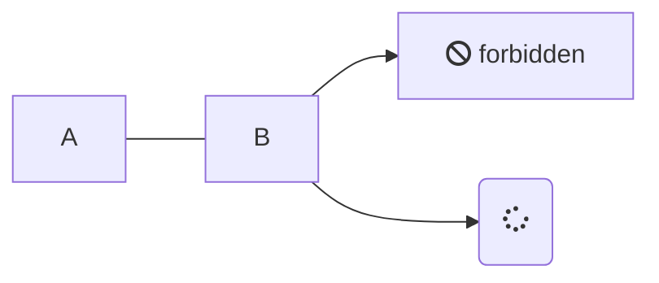
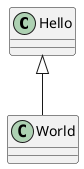

# rushdown-diagram
rushdown-diagram is a diagram plugin for [rushdown](https://github.com/yuin/rushdown), a markdown parser.
It allows you to easily embed diagrams in your markdown documents.

## Installation
Add dependency to your `Cargo.toml`:

```toml
[dependencies]
rushdown-diagram = "x.y.z"
```

## Syntax
Currently, rushdown-diagram supports diagrams in the following formats:

- MermaidJS
  - client-side rendering
  - server-side rendering (requires a `mmdc` command)
- PlantUML
  - server-side rendering (requires a `plantuml` command)

You can use the following syntax to embed diagrams:

`````markdown




`````

## Usage
### Example

`````rust
use rushdown::{
    new_markdown_to_html,
    parser::{self, ParserExtension},
    renderer::html::{self, RendererExtension},
};
use rushdown_diagram::{
    diagram_html_renderer_extension, diagram_parser_extension, DiagramHtmlRendererOptions,
    DiagramParserOptions,
};

let markdown_to_html = new_markdown_to_html(
    parser::Options::default(),
    html::Options::default(),
    diagram_parser_extension(DiagramParserOptions::default()),
    diagram_html_renderer_extension(DiagramHtmlRendererOptions::default()),
);
let mut output = String::new();
let input = r#"

"#;
match markdown_to_html(&mut output, input) {
    Ok(_) => {
        println!("HTML output:\n{}", output);
    }
    Err(e) => {
        println!("Error: {:?}", e);
    }
}
`````

### Options
`DiagramParserOptions` decides which languages are parsed as diagrams:

| Field | Type | Default | Description |
| --- | --- | --- | --- |
| `mermaid.enabled` | `bool` | `true` | Parse `mermaid` code blocks as diagrams. |
| `plantuml.enabled` | `bool` | `true` | Parse `plantuml` code blocks as diagrams. |

`DiagramHtmlRendererOptions` decides how diagrams are rendered:

| Field | Type | Default | Description |
| --- | --- | --- | --- |
| `mermaid` | `MermaidHtmlRenderingOptions` | `Client` with the latest jsDelivr URL | How MermaidJS diagrams are rendered. |
| `plantuml.command` | `Option<String>` | `None` | `plantuml` command path. `None` searches the `PATH`. |
| `plantuml.args` | `Vec<String>` | `[]` | Additional arguments passed to the `plantuml` command. |

`````rust
use rushdown_diagram::{
    ClientSideMermaidHtmlRenderingOptions, DiagramHtmlRendererOptions,
    MermaidHtmlRenderingOptions, PlantUmlHtmlRenderingOptions,
};

let options = DiagramHtmlRendererOptions {
    mermaid: MermaidHtmlRenderingOptions::Client(ClientSideMermaidHtmlRenderingOptions {
        mermaid_url: "https://example.com/mermaid.mjs",
    }),
    plantuml: PlantUmlHtmlRenderingOptions {
        command: Some(String::from("/usr/local/bin/plantuml")),
        args: vec![String::from("-charset"), String::from("UTF-8")],
    },
};
`````

### Server-side Mermaid
`MermaidHtmlRenderingOptions::Server` renders diagrams while converting to HTML by running the
[Mermaid CLI](https://github.com/mermaid-js/mermaid-cli) (`mmdc`), and embeds the resulting SVG.

| Field | Type | Default | Description |
| --- | --- | --- | --- |
| `command` | `Option<String>` | `None` | `mmdc` command path. `None` searches the `PATH`. |
| `args` | `Vec<String>` | `[]` | Additional arguments passed to the `mmdc` command. |
| `theme` | `MermaidThemeOptions` | `Single(MermaidTheme::default())` | Theme(s) used for rendering. |
| `output_dir` | `Option<PathBuf>` | `None` | Directory where SVGs are written. SVGs are embedded as data URIs when `None`. |
| `url_prefix` | `Option<String>` | `None` | URL prefix for the SVGs in `output_dir`. Defaults to `/` + the directory name. |

`MermaidThemeOptions::Dual { light, dark }` renders two SVGs and outputs a `<picture>` element that
switches by `prefers-color-scheme`. Written SVGs are cached by content and theme, so a diagram is
rendered again only when it changes.

`````rust
use std::path::PathBuf;

use rushdown_diagram::{
    DiagramHtmlRendererOptions, MermaidHtmlRenderingOptions, MermaidTheme, MermaidThemeOptions,
    ServerSideMermaidHtmlRenderingOptions,
};

let options = DiagramHtmlRendererOptions {
    mermaid: MermaidHtmlRenderingOptions::Server(ServerSideMermaidHtmlRenderingOptions {
        theme: MermaidThemeOptions::Dual {
            light: MermaidTheme::default(),
            dark: MermaidTheme::dark(),
        },
        output_dir: Some(PathBuf::from("public/diagrams")),
        ..Default::default()
    }),
    ..Default::default()
};
`````

## Testing
Tests use the `plantuml` and `mmdc` commands when they are installed; the server-side Mermaid
tests are skipped otherwise. `mmdc` is invoked with `tests/puppeteer-config.json`, which disables
the Chrome sandbox so that the tests also run in containers and CI.

## Donation
BTC: 1NEDSyUmo4SMTDP83JJQSWi1MvQUGGNMZB

Github sponsors also welcome.

## License
MIT

## Author
Yusuke Inuzuka
